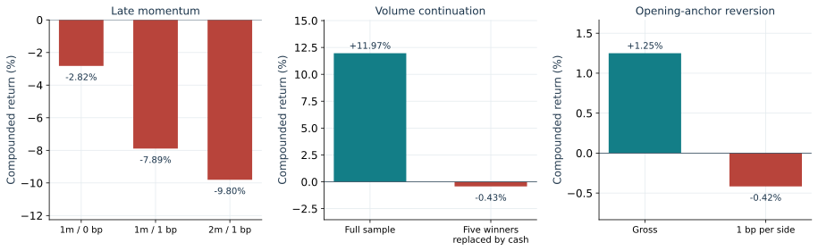
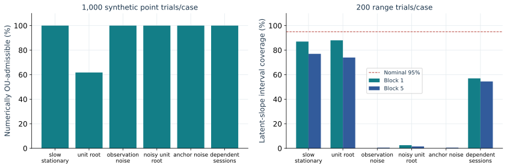
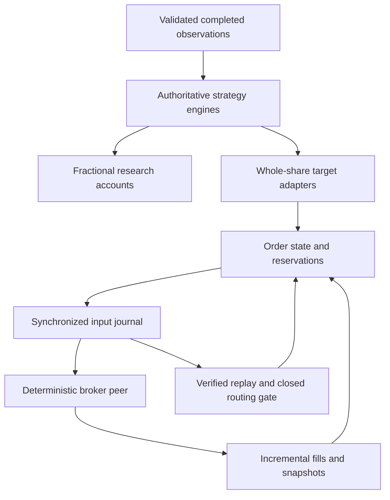
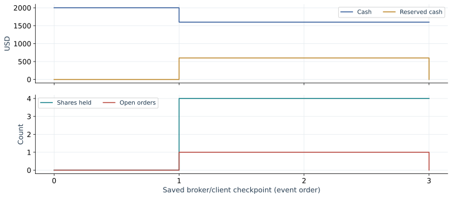
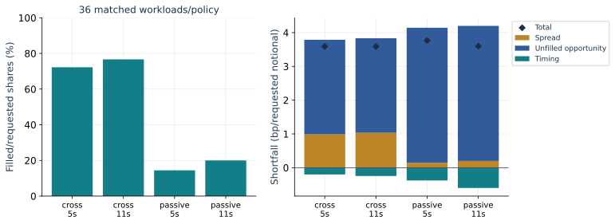
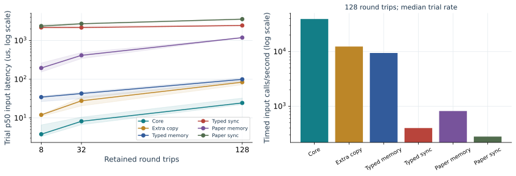

# Algorithmic Trading Runtime

C++20 software for prior-only strategy research, funded portfolio accounting,
synthetic broker execution and durable restart recovery. Three intraday strategy
families and a separate daily-risk experiment share authoritative numerical
engines. The extension covers **SPY, QQQ, IWM, TLT and GLD**: 2016 initializes
history, and 2017-2023 supplies development observations.

The [offline demo](#build-and-reproduce) runs without credentials or private data.
Detailed methods and executable commands are in the [runbook](docs/running.md).

**M0-M7 are complete: 8 of 11 milestones.** Stability, concentration, predefined
risk matching and uncertainty are accepted with explicit coverage limitations.
Validation in 2024, final retrospective evaluation in 2025 and consolidated
publication remain M8-M10. Those later
strategy inputs remain unopened. Prior research exposure is recorded in the
[roadmap](docs/extension_plan.md#research-exposure-and-evaluation-roles);
the reserved panel is not claimed to be globally unseen.

The accepted [primary M7 analysis](docs/stability.md#windows-development-acceptance)
covers 77 series and 1,760 development dates, with year, instrument, causal-condition
and holding-time attribution, winner concentration and paired six-endpoint
uncertainty plots.
The accepted [secondary and matched M7 analysis](docs/stability.md#windows-secondary-and-risk-matching-acceptance)
covers fourteen one-factor cases, 45 unit accounts, 50 funded matched accounts
and 345 derived series. None of the pooled matched endpoints meets the registered
calendar-coverage requirement. Development bounds do not authorize advancement,
and stopped account tails remain unavailable.

## Current extension results

| Evidence | Completed result | Interpretation |
| --- | --- | --- |
| [Registered panel](docs/extension_plan.md#m2-windows-registration-completed) | Five instruments, 2016-2025; 2,514 exchange dates and 12,570 symbol-days | Seven operational development years qualify under explicit amendments; the original complete-grid rule still fails |
| [Causal replay](docs/panel_replay.md) | 10,060 pre-2024 instrument-date records; original-SPY parity and independent source/history/target verification | Missing features and execution references remain explicit; availability does not establish an edge |
| [Shared-capital runtime](docs/shared_capital.md) | One USD balance, five inventories and fifteen owners; netting, admission limits and exact recovery | Constructed engineering evidence, separate from historical portfolio performance |
| [Independent broker](docs/process_broker.md) | Separate durable C++ peer; Windows acceptance passed 313 checks in twelve scenario families | Synthetic fills, fees, cancellation races, activity recovery and client/broker restarts; no external broker observations |
| [Historical cost/delay comparison](docs/cost_execution.md#windows-costdelay-acceptance) | 400 series and 240 paired contrasts on 1,682 common dates per instrument | Primary momentum and reversion net means are negative; positive relative differences remain development point estimates |
| [Quote references](docs/cost_execution.md#windows-quote-reference-acceptance) | 910 fixed windows; 232 eligible, all in 2022-2023 | Earlier sampled spread evidence remains unestimated; quotes do not calibrate all-in execution costs |
| [Synthetic execution](docs/cost_execution.md#windows-synthetic-execution-acceptance) | 680 cases, 510 matched contrasts and exact terminal reconciliation | Model-based execution sensitivity, not empirical fill probabilities or latency |
| [Continuous accounts](docs/cost_execution.md#windows-account-acceptance) | 200 risk and 50 shared accounts; 190 contrasts, with stops retained | 162,040 of 352,000 risk records and 2,750 of 88,000 shared days have observed returns |
| [Primary stability](docs/stability.md#windows-development-acceptance) | 77 series, 1,106 descriptive groups and six endpoints; Windows and derived-bundle verification passed | Momentum clears a provisional relative material bound while its own net mean remains negative; the risk endpoints lack adequate coverage. The pooled matched momentum comparison is unavailable, so its relative benefit is not confirmed after risk matching |
| [Secondary stability and risk matching](docs/stability.md#windows-secondary-and-risk-matching-acceptance) | Fourteen cases, 345 series and 5,077 descriptive groups; Windows execution and independent review completed | Both momentum duration alternatives and all six reversion candidate variants have negative pooled net means; the matched family is input-limited, with no simultaneous bounds |

The continuous-account limitation is material. Shared paths stop after **65
sessions at one-minute delay** or **45 at two minutes** when a required raw
execution reference is missing. Active risk paths also stop; only QQQ and TLT
passive accounts reach December 2023. No earlier liquidation, interpolation,
capital reset or restart repairs these paths. The eligible-date comparison and
recovered forecast histories do not establish full-horizon funded performance.
All case summaries, denominators and primary results are retained in the linked
acceptance records and curated CSV tables.

The runtime's accounting and recovery conclusions are separate from economic
benefit. M7 records sensitivity, exposure, concentration and uncertainty on
the evidence actually available; completed engineering checks do not advance a
failed strategy screen.

## Published SPY study

The [v1.0.0 release](https://github.com/KVInator/algorithmic-trading-runtime/releases/tag/v1.0.0)
is the completed **2022-2023 SPY** study. Its [technical report (PDF)](docs/report.pdf)
contains the research, 144 synthetic execution cases and archived Release
benchmarks. [Download its standalone HTML report](https://github.com/KVInator/algorithmic-trading-runtime/releases/download/v1.0.0/report.html)
for saved-event replay. The figures and results below retain that v1 scope;
they are not the extension's final publication.

## Research findings

The historical sample is inspected **2022-2023 development data**. No registered
candidate advances to later-period evaluation. Positive point returns and failed
advancement screens are reported together.

| Experiment | Sample | Main finding |
| --- | --- | --- |
| SPY-IM-01: late-session momentum | 496 dates; 268 active | Gross compounded return **-2.8207%**; primary net **-7.8924%**. No demonstrated gross edge. |
| SPY-TOD-01: time-of-day continuation | 476 scored dates after 20 warm-up sessions | Volume variant net **+11.9652%**, falling to **-0.4292%** when its five largest winning dates become cash. Both variants fail registered screens; the volume increment remains unconfirmed. |
| SPY-MR-01: opening-anchor reversion | 476 dates; 83 active | Candidate gross **+1.2498%**, primary net **-0.4171%**; cost-dominated and below the 100-active-date coverage convention. |
| SPY-RISK-01: daily risk allocation | 501 exchange dates; 40 account cases | Intraday-risk CER increment over daily-only **-1.5430 percentage points/year**. Positive QLIKE point improvement has intervals spanning zero. |

Primary intraday comparisons use one-minute delayed minute-open references and
**1 bp per side**. These are hypothetical all-in costs, not measured spreads or
broker fees. The designs have different information sets and holding windows;
the table is not a risk-matched performance ranking.



## Mathematical design

**Momentum and continuation.** Late momentum observes
$m_d=C_{d,15:29}/O_{d,09:30}-1$ at 15:30 and enters only when $m_d>0$.
Time-of-day continuation compares the current move $u_{d,m}$ with the mean absolute
same-clock move over twenty strictly earlier sessions:

$$
s_{d,m}=\frac{1}{20}\sum_{j=d-20}^{d-1}|u_{j,m}|.
$$

The volume variant also requires cumulative shares above the prior same-clock
median for fresh entries. Volume does not determine exits. Signals use completed
bars; delayed references occur after decisions. For one-way cost $c=k/10^4$:

$$
R(c)=\frac{P_x(1-c)}{P_e(1+c)}-1.
$$

**Opening-anchor reversion.** Five-minute log residuals around a fixed
volume-weighted opening-close anchor follow the estimated relation
$X_{k+1}=a+\phi X_k+\epsilon_{k+1}$. Pooled centered OLS uses 480 within-session
pairs from twenty prior sessions. For an admissible positive sub-unit slope:

$$
\theta=\frac{a}{1-\phi},\qquad
\kappa=-\frac{\log\phi}{5},\qquad
 g(x;\delta,H)=(\theta-x)e^{-\kappa\delta}(1-e^{-\kappa H}).
$$

The noon candidate compares this expected delayed move with the fixed primary
log-cost hurdle. Unsupported fits produce dated cash decisions. Numerical
OU admissibility does not establish stationarity or identify a latent diffusion.
The synthetic noise study demonstrates false admissibility and interval
undercoverage; historical parameter ranges remain descriptive.



**Daily risk.** Prior-only daily-squared-return and RV5 estimates feed
$w_d=\min(1,0.10/\sqrt{252h_d})$. Fractional accounts retain cash, shares,
dividend receivables/payments and split identities. Forecast loss and allocation
value are separate questions. The v1 inference uses paired whole-calendar
resampling: five-/ten-session outcome blocks for intraday studies and
twenty/forty for risk. Extension-wide inference is reported in M7; controlled
statistical calibration remains M8. Fixed
screens and prior research exposure remain explicit in the
[registered protocols](research/README.md).

## Decisions, orders and recovery



The core reserves cash or shares before dispatch eligibility. Partial fills apply
exact integer money once per stable execution identity. Pending cancellation
retains resources. Contradictory evidence closes entry; broker snapshots must
match cash, positions and complete open-order terms before routing reopens.

Shared-client schema 4 and independent-broker schema 5 use **USD 1e-9 units**
with explicit ownership and stable identities. The v1 schema-3 message bridge
retains its original single-symbol contract. A candidate input/checkpoint is appended and synchronized before state publication.
Recovery replays the same core and persists a new disconnect barrier. An
incomplete tail can be recovered only into a separate verified-prefix file;
complete corruption is rejected. Uncertain durable orders are not blindly resent.
Local once-only accounting does not guarantee exactly-once external dispatch.



`project_demo` exposes a keyboard-operable event playhead, targets, fills,
reservations, client/broker state, account-parity cases and interrupted paths.
Its **259 checks across 24 cases** run without credentials or private data.
Quotes, messages and event times are synthetic. Historical Alpaca acquisition is
preserved separately; no paid feed or native broker service is required.

## Execution measurements

Four fixed limit/deadline policies run on 36 matched quote/delivery workloads,
yielding **144 accounts, 108 paired policy comparisons and 120 assumption
comparisons**. Signed arrival-midpoint shortfall is decomposed into spread and
timing; unfilled shares receive a separate common-terminal opportunity mark.
The arithmetic retains exact half-cents.

| Policy | Filled/requested shares | Completed cases / 36 | Total marked shortfall, bp of requested notional |
| --- | ---: | ---: | ---: |
| Crossing limit; 5-second cancel | 72.22% | 20 | 3.5889 |
| Crossing limit; 11-second cancel | 76.67% | 24 | 3.5889 |
| Same-side limit; 5-second cancel | 14.44% | 0 | 3.7667 |
| Same-side limit; 11-second cancel | 20.00% | 0 | 3.6000 |



These are constructed workload aggregates, not empirical fill probabilities.
Source and receipt clocks are distinct. Incomplete completion times stay null;
cancellation is informative censoring. Synthetic prices do not estimate market
impact, exchange queue priority or actual broker latency.

## Archived implementation measurements

Matched Release workloads compare direct processing, additional candidate
copying, volatile/synchronized schema-2 and schema-3 journals, and warm restart.
At 128 round trips on the verified Windows workstation:

| Operation | Median of five trial p50 values |
| --- | ---: |
| Direct core input | 24.4 us |
| Input with additional candidate copy | 83.8 us |
| Synchronized typed-journal input | 2.4384 ms |
| Synchronized paper-journal input | 3.5602 ms |
| Typed warm recovery | 72.7635 ms |
| Paper warm recovery | 982.5807 ms |



MSVC 19.51.36260.0 Release uses `/O2 /Ob2 /DNDEBUG`, C++20 and warnings as errors.
The OS reports Intel Family 6 Model 183, 24 logical processors. Process-wide peak
working set is 20.730 MiB; this does not isolate per-case allocations. Throughput
uses summed timed calls, excluding preparation, validation and reporting. Recovery
reads are warm-cache. Timings depend on the host, storage and instrumentation.

The published Windows timings are archived reference measurements. The
[original benchmark evidence](https://github.com/KVInator/algorithmic-trading-runtime/releases/download/v1.0.0/windows-runtime-benchmark.zip)
contains raw timed samples, journals, source inventory and host metadata. Its
summary identity is recorded in the [evidence manifest](docs/evidence/manifest.json).

Journals are bounded to **10,000 inputs, 32 MiB per file and 64 KiB per frame**.
Copies and retained histories have measured costs; no capacity extrapolation,
low-latency target, rotation or compaction is claimed.

## Build and reproduce

Windows requires Visual Studio 2022 or 2026 with **Desktop development with C++**,
a Windows SDK and Python 3.10+ with the `py` launcher. Open **Runtime.sln**, select
**Release | x64**, then **Build > Build Solution**. Press **Ctrl+F5** to run
`project_demo` and open its printed `report.html`. Select **Debug | x64** when
stepping through code. Executables are written to `scratch/native/<configuration>/`.

Linux requires Python 3.10+, GCC/Clang with C++20, `ar` and OpenSSL development headers:

```sh
python -B build.py --configuration Release
scratch/native/Release/project_demo
python -B research/verify_project_demo.py scratch/runs/project_demo_0
```

Use the actual printed suffix. The first build acquires checksum-pinned
nlohmann/json 3.12.0; subsequent builds reuse the local headers and current
objects. `build.py --target project_demo --run` builds and runs one application.
The native solution delegates to this same compiler driver, so there is one
build definition for the shared core and applications.

The [runbook](docs/running.md) covers execution measurements, benchmarks,
historical acquisition/reproduction and rebuilding the publication. Independent
Python checks reconstruct Decimal ledgers, fit/statistical references, quote
budgets, source/receipt timing, censoring and artifact identities. Full historical
reproduction requires the retained private input evidence; the distributed
[summary snapshot](docs/evidence/manifest.json) does not manufacture daily paths.

The archived [v1 acceptance run](https://github.com/KVInator/algorithmic-trading-runtime/actions/runs/40224499759)
records Windows Release/Debug and Linux Release verification at its stated
revision. Current extension checks and accepted Windows outputs are recorded in
the [roadmap](docs/extension_plan.md) and linked methodology notes. Independent
verification runs through explicit local commands; there is no hosted workflow.

## Structure and limits

| Location | Responsibility |
| --- | --- |
| `src/market`, `src/alpaca`, `src/storage`, `src/platform` | Validated observations, message contracts, integrity and platform resources |
| `src/research`, `src/accounting` | Authoritative causal models, statistics and fractional accounts |
| `src/execution` | Whole-share runtime, journals, adapters and deterministic broker/replay scenarios |
| `src/reporting`, `apps` | Result-bound exports and thin composition roots |
| `research/verify_*.py` | Independent numerical, accounting and artifact references |
| `docs` | Technical report, curated figures/evidence and operational contracts |
| `Runtime.sln`, `Runtime.vcxproj`, `build.py` | Native Visual Studio entry point and shared compiler driver |

The [architecture](docs/architecture.md) explains ownership and units.
Generated builds, private data and full run directories stay under ignored
`scratch/`.

The original research covers one ETF and two inspected development years.
The extension adds five instruments and a broader development calendar, with
correlated equity exposures and material missing-reference limits. Both retain
long/cash scope, finalized historical bars, assumed all-in charges and
uncalibrated synthetic liquidity. Later-period evaluation, statistical stability
and exposure matching are unfinished. No live-trading edge is established.
