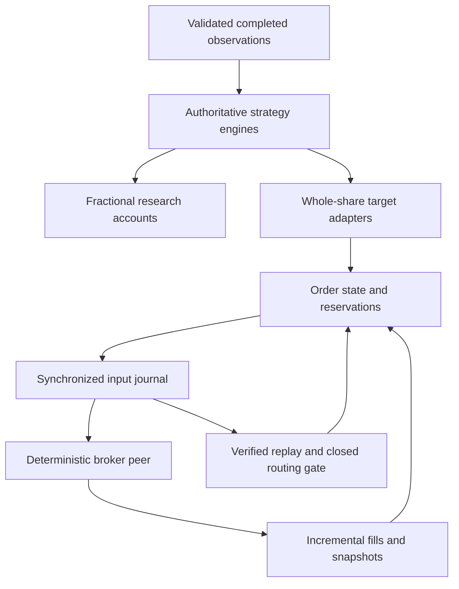

# Algorithmic Trading Runtime

C++20 software for causal strategy research, exact order accounting,
synthetic broker-message processing and durable restart recovery.
The published v1 research uses inspected **2022-2023 SPY development data**; broker
events and execution workloads are constructed offline scenarios.

The project contains **three intraday strategy families**, a separate daily-risk
study, **144 matched synthetic execution cases** and **120 Release benchmark
trials per host**. Python provides independent numerical verification and
publication rendering.

Read the [technical report (PDF)](docs/report.pdf) for the mathematics,
results and assumptions. For the interactive saved-event replay,
[download the standalone HTML report](https://github.com/KVInator/algorithmic-trading-runtime/releases/download/v1.0.0/report.html)
and open it locally. The [v1.0.0 release](https://github.com/KVInator/algorithmic-trading-runtime/releases/tag/v1.0.0)
contains the report downloads and original Windows benchmark evidence.

The [multi-instrument extension](docs/extension_plan.md) has completed
**M0-M5: 6 of 11 milestones**. A Windows Release run registered the 2016-2025
panel for **SPY, QQQ, IWM, TLT and GLD**, covering 2,514 exchange dates and
12,570 symbol-days. The original SPY vintage bridge matched all 202,103 retained
bars across 752 development and calibration windows, with no changed or missing
original bars.

The registered [input and source amendments](research/extension_input_policy.md)
qualify seven operational development years; the parent complete-grid criterion
still qualifies only four and remains recorded as failed. The three unavailable
2019 closing marks remain NA and reset daily history. Issuer cash authority and
secondary split cross-checks are bound to the new study manifest. These are input
registration findings, not expanded strategy results.

**M3 is complete:** the [causal panel runner](docs/panel_replay.md) replayed
2,012 dates through 2023 across all five instruments, producing 10,060 records.
Windows native checks and original-SPY reference parity passed. Independent
verification checked source observations, prior-only histories, fits, targets
and arithmetic. The common operational development mask contains 1,682 dates
per instrument. The [M4 shared-capital diagnostic](docs/shared_capital.md) now
exercises one cash balance, fifteen strategy owners, netting, aggregate admission
limits and durable recovery. Windows Release acceptance passed 182 native checks
in 15 synthetic cases, with 163 durable transitions independently verified.
Broader historical economic comparisons remain later work.
The [M5 broker extension](docs/process_broker.md) adds a separate native process,
independent durable activities, DAY/IOC/GTC limits, explicit fees and recovery
through missed responses or client/broker restarts. Windows Release passed
313 checks in twelve scenario families across twenty-one child processes.
Independent review verified the broker history, client attribution and peer calls.

**M6 is in progress:** the [cost and execution contract](docs/cost_execution.md)
registers the cost/delay comparisons and 680 synthetic execution cases. Its
first checkpoint provides a resumable, fully paginated sample of 910 pre-2024
SIP quote windows selected from input masks. Windows acquisition retained 1,322
responses; 232 windows pass the fixed eligibility rule, all in 2022-2023.
The report shows static coverage/spread plots and explicit unavailable groups.
Cached inspection reproduced every classification: sampled 2017-2021 quotes
carry `["?"]`, while 2022-2023 quotes carry `["R"]`. Of 76 timestamp conflicts,
67 change size, three change price and six change exchange metadata only.
The [diagnosis](docs/cost_execution.md#cached-condition-and-timestamp-diagnosis)
retains the eligibility rule and limits eligible spread evidence to 2022-2023.
The historical cost/delay evaluator now replays the same eight primary policies
across all ten registered cost/delay cases: 400 instrument/policy series and
240 paired contrasts, with static cost curves and an independent Decimal oracle.
Windows development acceptance passed on 29 October 2026: all cases use 1,682
common dates per instrument in 2017-2023. At the primary cost/delay, equal-weight
net increments are +1.3687 bp/day for momentum versus always-long, +0.2412 for
volume versus price-only continuation, and +0.6165/+0.0031 for reversion versus
sign-only/drift. Momentum and reversion candidate net means remain negative;
these are development point estimates pending stability and uncertainty checks.
The [accepted cost/delay results](docs/cost_execution.md#windows-costdelay-acceptance)
retain the complete tables and review limits. Quote-reference comparisons,
continuous daily-risk accounts and shared-account economic integration remain open.
The registered [synthetic execution study](docs/cost_execution.md#registered-synthetic-execution-study)
now executes all 680 cases through the existing five-symbol broker model and a
separate client ledger, with 510 matched contrasts, explicit fees and delivery
clocks. [Windows acceptance](docs/cost_execution.md#windows-synthetic-execution-acceptance)
passed on 29 October 2026; all 680 case traces match the GNU reference byte for byte.
Its heatmaps retain unfilled/stale/zero-liquidity cases. Identical constructed
symbol paths are engineering evidence, separate from historical market results.

The 2024 validation and 2025 final-evaluation strategy inputs remain unopened
until M8 and M9. The [registration record](docs/extension_plan.md#m2-windows-registration-completed)
retains the artifact identities and review limits. The results below describe
the completed v1 study.

## Research findings

The historical sample is inspected **2022-2023 development data**. No registered
candidate advances to later-period evaluation. Positive point returns and failed
advancement screens are reported together.

| Experiment | Sample | Main finding |
| --- | --- | --- |
| SPY-IM-01: late-session momentum | 496 dates; 268 active | Gross compounded return **-2.8207%**; primary net **-7.8924%**. No demonstrated gross edge. |
| SPY-TOD-01: time-of-day continuation | 476 scored dates after 20 warm-up sessions | Volume variant net **+11.9652%**, falling to **-0.4292%** when its five largest winning dates become cash. Both variants fail registered screens; the volume increment remains unconfirmed. |
| SPY-MR-01: opening-anchor reversion | 476 dates; 83 active | Candidate gross **+1.2498%**, primary net **-0.4171%**; cost-dominated and below the 100-active-date coverage convention. |
| SPY-RISK-01: daily risk allocation | 501 exchange dates; 40 account cases | Intraday-risk CER increment over daily-only **-1.5430 percentage points/year**. Positive QLIKE point improvement has intervals spanning zero. |

Primary intraday comparisons use one-minute delayed minute-open references and
**1 bp per side**. These are hypothetical all-in costs, not measured spreads or
broker fees. The designs have different information sets and holding windows;
the table is not a risk-matched performance ranking.


## Mathematical design

**Momentum and continuation.** Late momentum observes
$m_d=C_{d,15:29}/O_{d,09:30}-1$ at 15:30 and enters only when $m_d>0$.
Time-of-day continuation compares the current move $u_{d,m}$ with the mean absolute
same-clock move over twenty strictly earlier sessions:

$$
s_{d,m}=\frac{1}{20}\sum_{j=d-20}^{d-1}|u_{j,m}|.
$$

The volume variant also requires cumulative shares above the prior same-clock
median for fresh entries. Volume does not determine exits. Signals use completed
bars; delayed references occur after decisions. For one-way cost $c=k/10^4$:

$$
R(c)=\frac{P_x(1-c)}{P_e(1+c)}-1.
$$

**Opening-anchor reversion.** Five-minute log residuals around a fixed
volume-weighted opening-close anchor follow the estimated relation
$X_{k+1}=a+\phi X_k+\epsilon_{k+1}$. Pooled centered OLS uses 480 within-session
pairs from twenty prior sessions. For an admissible positive sub-unit slope:

$$
\theta=\frac{a}{1-\phi},\qquad
\kappa=-\frac{\log\phi}{5},\qquad
 g(x;\delta,H)=(\theta-x)e^{-\kappa\delta}(1-e^{-\kappa H}).
$$

The noon candidate compares this expected delayed move with the fixed primary
log-cost hurdle. Unsupported fits produce dated cash decisions. Numerical
OU admissibility does not establish stationarity or identify a latent diffusion.
The synthetic noise study demonstrates false admissibility and interval
undercoverage; historical parameter ranges remain descriptive.


**Daily risk.** Prior-only daily-squared-return and RV5 estimates feed
$w_d=\min(1,0.10/\sqrt{252h_d})$. Fractional accounts retain cash, shares,
dividend receivables/payments and split identities. Forecast loss and allocation
value are assessed separately using paired whole-calendar resampling. Intraday
studies use five-/ten-session outcome blocks; risk uses twenty/forty. Fixed
screens and prior research exposure remain explicit in the
[registered protocols](research/README.md).

## Decisions, orders and recovery



The core reserves cash or shares before dispatch eligibility. Partial fills apply
exact integer money once per stable execution identity. Pending cancellation
retains resources. Contradictory evidence closes entry; broker snapshots must
match cash, positions and complete open-order terms before routing reopens.

The schema-3 bridge uses **USD 1e-9 units** and durable broker identities. A
candidate input/checkpoint is appended and synchronized before state publication.
Recovery replays the same core and persists a new disconnect barrier. An
incomplete tail can be recovered only into a separate verified-prefix file;
complete corruption is rejected. Uncertain durable orders are not blindly resent.
Local once-only accounting does not guarantee exactly-once external dispatch.


`project_demo` exposes a keyboard-operable event playhead, targets, fills,
reservations, client/broker state, account-parity cases and interrupted paths.
Its **259 checks across 24 cases** run without credentials or private data.
Quotes, messages and event times are synthetic. Historical Alpaca acquisition is
preserved separately; no paid feed or native broker service is required.

## Execution measurements

Four fixed limit/deadline policies run on 36 matched quote/delivery workloads,
yielding **144 accounts, 108 paired policy comparisons and 120 assumption
comparisons**. Signed arrival-midpoint shortfall is decomposed into spread and
timing; unfilled shares receive a separate common-terminal opportunity mark.
The arithmetic retains exact half-cents.

| Policy | Filled/requested shares | Completed cases / 36 | Total marked shortfall, bp of requested notional |
| --- | ---: | ---: | ---: |
| Crossing limit; 5-second cancel | 72.22% | 20 | 3.5889 |
| Crossing limit; 11-second cancel | 76.67% | 24 | 3.5889 |
| Same-side limit; 5-second cancel | 14.44% | 0 | 3.7667 |
| Same-side limit; 11-second cancel | 20.00% | 0 | 3.6000 |


These are constructed workload aggregates, not empirical fill probabilities.
Source and receipt clocks are distinct. Incomplete completion times stay null;
cancellation is informative censoring. Synthetic prices do not estimate market
impact, exchange queue priority or actual broker latency.

## Measured implementation costs

Matched Release workloads compare direct processing, additional candidate
copying, volatile/synchronized schema-2 and schema-3 journals, and warm restart.
At 128 round trips on the verified Windows workstation:

| Operation | Median of five trial p50 values |
| --- | ---: |
| Direct core input | 24.4 us |
| Input with additional candidate copy | 83.8 us |
| Synchronized typed-journal input | 2.4384 ms |
| Synchronized paper-journal input | 3.5602 ms |
| Typed warm recovery | 72.7635 ms |
| Paper warm recovery | 982.5807 ms |


MSVC 19.51.36260.0 Release uses `/O2 /Ob2 /DNDEBUG`, C++20 and warnings as errors.
The OS reports Intel Family 6 Model 183, 24 logical processors. Process-wide peak
working set is 20.730 MiB; this does not isolate per-case allocations. Throughput
uses summed timed calls, excluding preparation, validation and reporting. Recovery
reads are warm-cache. Timings depend on the host, storage and instrumentation.

The published Windows timings are archived reference measurements. The
[original benchmark evidence](https://github.com/KVInator/algorithmic-trading-runtime/releases/download/v1.0.0/windows-runtime-benchmark.zip)
contains raw timed samples, journals, source inventory and host metadata. Its
summary identity is recorded in the [evidence manifest](docs/evidence/manifest.json).

Journals are bounded to **10,000 inputs, 32 MiB per file and 64 KiB per frame**.
Copies and retained histories have measured costs; no capacity extrapolation,
low-latency target, rotation or compaction is claimed.

## Build and reproduce

Windows requires Visual Studio 2022 or 2026 with **Desktop development with C++**,
a Windows SDK and Python 3.10+ with the `py` launcher. Open **Runtime.sln**, select
**Release | x64**, then **Build > Build Solution**. Press **Ctrl+F5** to run
`project_demo` and open its printed `report.html`. Select **Debug | x64** when
stepping through code. Executables are written to `scratch/native/<configuration>/`.

Linux requires Python 3.10+, GCC/Clang with C++20, `ar` and OpenSSL development headers:

```sh
python -B build.py --configuration Release
scratch/native/Release/project_demo
python -B research/verify_project_demo.py scratch/runs/project_demo_0
```

Use the actual printed suffix. The first build acquires checksum-pinned
nlohmann/json 3.12.0; subsequent builds reuse the local headers and current
objects. `build.py --target project_demo --run` builds and runs one application.
The native solution delegates to this same compiler driver, so there is one
build definition for the shared core and applications.

The [runbook](docs/running.md) covers execution measurements, benchmarks,
historical acquisition/reproduction and rebuilding the publication. Independent
Python checks reconstruct Decimal ledgers, fit/statistical references, quote
budgets, source/receipt timing, censoring and artifact identities. Full historical
reproduction requires the retained private input evidence; the distributed
[summary snapshot](docs/evidence/manifest.json) does not manufacture daily paths.

The native build was accepted on Windows Release/Debug and Linux Release at
commit [`2e566bb`](https://github.com/KVInator/algorithmic-trading-runtime/commit/2e566bb7dee677b57af7fce1fba3e2b31c6643a7).
The [acceptance run](https://github.com/KVInator/algorithmic-trading-runtime/actions/runs/40224499759)
exercised the offline demo, independent execution and benchmark verification,
and publication checks. The v1.0.0 application code and compiler driver match
that accepted revision. Current extension changes have a separate verification
record in the [extension plan](docs/extension_plan.md). Commit
[`34c7ab7`](https://github.com/KVInator/algorithmic-trading-runtime/commit/34c7ab7fc8feff53a8210312cb4284c530cd3332)
removed only the temporary workflow; subsequent release edits update documentation
and ignore rules.

The earlier [29-group regression run](https://github.com/KVInator/algorithmic-trading-runtime/actions/runs/40218027491)
applies to revision `ee0b72e`. The final repository retains explicit local
verification commands and has no continuous CI workflow. PDF page layout was
reviewed separately from automated publication verification.

## Structure and limits

| Location | Responsibility |
| --- | --- |
| `src/market`, `src/alpaca`, `src/storage`, `src/platform` | Validated observations, message contracts, integrity and platform resources |
| `src/research`, `src/accounting` | Authoritative causal models, statistics and fractional accounts |
| `src/execution` | Whole-share runtime, journals, adapters and deterministic broker/replay scenarios |
| `src/reporting`, `apps` | Result-bound exports and thin composition roots |
| `research/verify_*.py` | Independent numerical, accounting and artifact references |
| `docs` | Technical report, curated figures/evidence and operational contracts |
| `Runtime.sln`, `Runtime.vcxproj`, `build.py` | Native Visual Studio entry point and shared compiler driver |

The [architecture](docs/architecture.md) explains ownership and units.
Generated builds, private data and full run directories stay under ignored
`scratch/`.

The evidence is limited by one ETF, two inspected development years,
finalized historical bars, assumed costs, long/cash scope, observation-model
identification and uncalibrated synthetic liquidity. Local **2024-2025 strategy
prices and performance remain unopened**. The project is a completed bounded
research and execution study, with no demonstrated live-trading edge.
