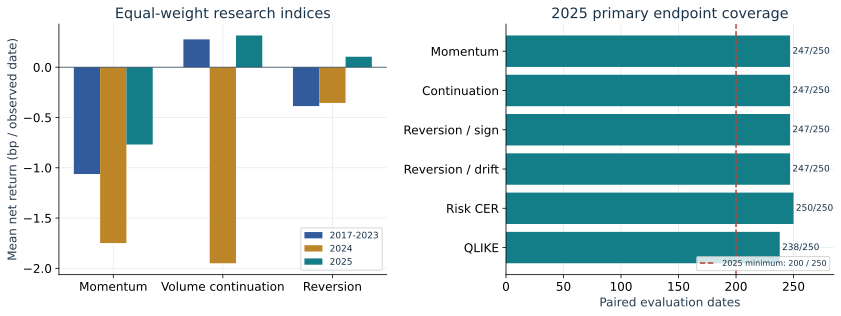
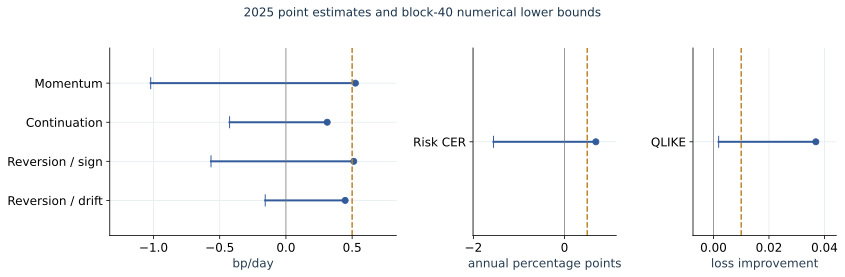
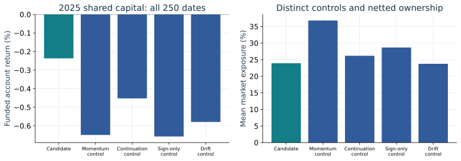

# Algorithmic trading research and execution

C++20 software for causal strategy research, funded portfolio accounting and
synthetic order execution with durable recovery. The study evaluates momentum,
volume-conditioned continuation and opening-anchor mean reversion across
**SPY, QQQ, IWM, TLT and GLD**, with a separate daily-risk allocation experiment.

The registered archive spans **2016-2025**. Histories initialize in 2016;
2017-2023 supplies retrospective development observations, followed by 2024
validation and a frozen 2025 final evaluation. The implementation separates
statistical evidence, account economics and operational correctness.

The [technical report](docs/report.pdf) contains the mathematics, experiment
specification and results. Its [standalone HTML version](docs/report.html)
embeds saved synthetic event views and opens without a server or JavaScript.
The original [SPY release](https://github.com/KVInator/algorithmic-trading-runtime/releases/tag/v1.0.0)
retains its two-year scope; the current publication includes the full extension.

## Reference results

The final evaluation retains **77 primary series, 345 secondary/matched series,
14 parameter variations, 200 risk-account cases and 50 shared-capital cases**.
Historical comparisons use fixed minute-open references and explicit hypothetical
costs. Synthetic broker fills are a separate experiment.

| 2025 result | Recorded outcome |
| --- | ---: |
| Evaluation exchange sessions | 250 |
| Common observed dates for pooled intraday indices | 247 |
| Momentum index mean, net bp per observed date | -0.7684 |
| Volume-conditioned continuation index mean | +0.3157 |
| Reversion candidate index mean | +0.1042 |
| Primary shared candidate, terminal equity from USD 100,000 | USD 99,763.25 |
| Primary shared candidate, funded return | -0.2367% |
| Risk/shared cases completing the evaluation year | 200 / 50 |

These primary results use **1 bp per side and one-minute delay**. Equal-weight
research indices are distinct from funded shared wealth. Both positive index
means become negative when their largest winning date is set to zero while
retaining the original denominator.



Development, validation and final index means use their retained common-date
masks. Earlier funded paths can stop on missing required inputs; they are not
silently restarted or extended through unavailable observations.

All six final primary endpoints meet the registered coverage requirement,
including **238/250 QLIKE pairs**. No primary numerical lower bound exceeds its
material increment at any registered block length. Controlled calibration finds
size excess in **19/20 case/block cells**, so the numerical bounds do not carry a
validated nominal 95% simultaneous-confidence interpretation. The complete
risk-matched family remains unavailable because reversion versus drift has no
paired observations. No strategy earns advancement under the registered design.



Dots are point estimates, left ticks are block-40 numerical lower bounds, and
gold dashed lines are material thresholds. Return, annual CER and QLIKE panels
use different units. These are not two-sided confidence intervals.
The [acceptance record](docs/validation.md#windows-provider-2025-final-acceptance)
and [source-bound endpoint table](docs/evidence/m9_final_endpoints.csv) retain
all comparisons, including unavailable matched outcomes.

## Mathematical design

### Causal signals

Momentum enters long only after a positive completed late-session move.
Continuation compares the current opening-relative move with the mean absolute
same-clock move in twenty earlier sessions:

$$
s_{d,m}=\frac{1}{20}\sum_{j=d-20}^{d-1}|u_{j,m}|.
$$

The volume variant additionally requires current cumulative volume above its
prior same-clock median for fresh entries. Volume does not determine exits.
Decisions use completed bars; delayed execution references occur afterward.
For a round trip with one-way charge $c=k/10^4$,

$$
R(c)=\frac{P_x(1-c)}{P_e(1+c)}-1.
$$

Opening-anchor reversion fits five-minute log residuals from twenty prior
sessions as $X_{k+1}=a+\phi X_k+\epsilon_{k+1}$. For an admissible positive
sub-unit slope, its OU mapping is

$$
\theta=\frac{a}{1-\phi},\qquad
\kappa=-\frac{\log\phi}{5},\qquad
 g(x;\delta,H)=(\theta-x)e^{-\kappa\delta}(1-e^{-\kappa H}).
$$

The candidate compares the expected delayed move with a fixed cost hurdle.
Numerical OU admissibility does not establish stationarity or identify a latent
diffusion. Constructed finite-sample, near-unit and observation-noise cases
measure coefficient behavior and interval coverage independently of profitability.

### Risk, capital and costs

The separate risk study compares strictly lagged daily-only and intraday-aware
risk estimates. Fractional accounts carry cash, shares, dividend receivables,
actual payment dates and split identities. Missing required marks produce dated
unavailable outcomes; consecutive forecast histories reset rather than bridging
the gap. Forecast-history recovery does not restart a stopped economic ledger.

The predefined exposure comparison uses 252 prior session slots. Candidate and
control are scaled toward the smaller of their estimated annual volatilities
and a fixed 10% target:

```math
\sigma_{t}^{\ast} = \min\left(0.10,\; \widehat{\sigma}_{c,t-1},\; \widehat{\sigma}_{b,t-1}\right), \qquad w_{j,t} = \frac{\sigma_{t}^{\ast}}{\widehat{\sigma}_{j,t-1}}
```

Missing slots are retained and unsupported sizing stays unavailable. All fourteen
one-factor history, observation-grid and holding-period variations remain in the
analysis. They do not select replacement settings after final inspection.

The historical cost grid is **0, 0.5, 1, 2 and 5 bp per side**, at one- and
two-minute delays: 400 instrument/policy/cost/delay series and 240 paired
comparisons. A separate fixed historical quote sample retains 910 windows,
232 eligible under the registered rule. Quote crossing references do not estimate
market impact, queue position or synthetic fill probabilities.

### Dependence and uncertainty

Paired full-calendar moving-block resampling retains missing slots and uses
joint draws across the six registered endpoints. With HAC standard error
$\widehat s_j$, the numerical lower bound is

$$
L_j=\widehat\theta_j-c_{0.95}\widehat s_j.
$$

Blocks 5, 10, 20 and 40 and the complete family remain fixed. The controlled
calibration runs 20,000 outer families and retains the observed size failures.
Coverage, uncertainty, concentration, exposure, turnover, costs and drawdown
are reported beside returns. Detailed assumptions are in the
[statistical specification](docs/validation.md).

## Shared capital and synthetic broker

One whole-share USD account supports five inventories and fifteen strategy
owners. Explicit ownership, target netting and aggregate limits operate on
actual balances. The independently journaled synthetic broker runs in a separate
native child process and reuses the same matching core as the in-process peer.

The process study covers **313 checks in twelve scenario families across 21
child processes**. DAY, IOC and GTC limit orders, partial fills, cancel/new
replacement, fees, disconnected delivery and activity-first recovery have
explicit contracts. The 680-case execution study independently reconciles every
terminal broker/client account and retains 510 matched contrasts.



All five displayed 2025 accounts start at USD 100,000 and complete 250 dates.
The primary candidate pays USD 1,759.59 in charges and has 23.9159% mean exposure.
Differences between these controls are not risk-matched alpha estimates.

`OrderRuntime`, `SharedCapitalBook` and their journal owners maintain exact
integer money, whole shares, reservations and stable execution identities.
Schemas explicitly distinguish cents from USD 1e-9. Framed records and
checksums detect corruption; candidate state is synchronized before dispatch
eligibility is published. Recovery replays the same accounting rules and
reconciles independent activity before a snapshot can reopen routing.

These are synthetic execution results. Anonymous pipes, deterministic quote
budgets and simulated fills do not demonstrate external-broker connectivity,
real-market liquidity or production readiness. Historical Alpaca acquisition
remains available; no paid feed or live broker service is required.

## Runtime measurements

The archived Release benchmark has 120 rows over eight processing/recovery
modes and five repetitions at 8, 32 and 128 round trips. At 128 round trips,
Windows median trial p50 is **24.4 us for direct core calls**, **2.4384 ms for
synchronized typed journals**, and **3.5602 ms for synchronized paper journals**.
These measure the original bounded single-symbol workload, not the expanded
five-instrument peer or end-to-end market latency.


Raw timings, compiler/host identities and variability are retained. Cross-host
Windows/Linux differences cannot isolate an operating-system effect.
The [benchmark contract](docs/runtime_benchmark.md) specifies timer scope,
warm-cache recovery, instrumentation and resource limits.

## Build and reproduce

Requirements: Python 3.10+ and C++20. Windows uses Visual Studio 2022/2026 with
Desktop development with C++ and a Windows SDK. Linux uses GCC/Clang, `ar` and
OpenSSL development headers. The first build acquires pinned nlohmann/json
3.12.0; `--json-include` supports a preinstalled copy.

```powershell
py -3 -B build.py --configuration Release --target project_demo
& .\scratch\native\Release\project_demo.exe
py -3 -B research/verify_publication.py
```

On Linux use `python` instead of `py -3`, forward-slash paths and no `.exe`
suffix. In Visual Studio, open `Runtime.sln`, select **Release | x64** and build;
**Ctrl+F5** runs the default demo. Debug is for stepping through code. There is
one Python build driver, with no CMake/CTest layer or hosted workflow.

The offline demo needs no market credentials or private dataset. Full historical
reproduction requires the registered raw archive, issuer/action references,
calibration and original/replacement frozen-run evidence. Public summary tables
cannot reconstruct omitted observations. The [runbook](docs/running.md) gives
supported entry points, exact verification routes and publication commands.

## Implementation and evidence

| Location | Responsibility |
| --- | --- |
| `src/research` | Prior-only models, registered comparisons, risk and inference |
| `src/accounting`, `src/execution` | Fractional/whole-share ledgers, ownership, broker matching and recovery |
| `src/market`, `src/alpaca`, `src/storage`, `src/platform` | Validated observations, archive identities and platform resources |
| `src/reporting`, `apps` | Result-bound reports and thin application composition |
| `research` | Frozen protocols, issuer-data preparation and one publication builder |
| `docs` | Methods, curated source-bound tables, figures and standalone report |
| `scratch` | Ignored datasets, builds, experiments and full run evidence |

The engines have one authoritative C++ implementation. The complete independent
Python verification suite is retained at the [verified publication revision](https://github.com/KVInator/algorithmic-trading-runtime/tree/409508fe3e90550052dc691147ffe4834b13089a/research),
with an explicit [checkout and execution route](docs/running.md#scientific-verification).
The report's original scientific verification commands apply to that complete
revision. The current tree retains only build, issuer-data and publication utilities.
Pure formulas remain small functions; domain owners enforce state and resource
invariants. The [architecture](docs/architecture.md),
[study design](docs/extension_plan.md) and [evidence manifest](docs/evidence/manifest.json)
specify the boundaries.

The universe is selected and includes correlated equity exposures. Earlier GLD
research and inspected SPY outcomes prevent a globally untouched-sample claim.
Historical final bars, hypothetical costs, no cash yield, uncalibrated synthetic
liquidity and bounded journals limit interpretation. Stopped development paths
remain unavailable. No settings were selected from final results.

## References

- Gao, Han, Li and Zhou (2018), [Market intraday momentum](https://doi.org/10.1016/j.jfineco.2018.05.009).
- Moreira and Muir (2017), [Volatility-managed portfolios](https://www.nber.org/papers/w22208).
- Kunsch (1989), [The jackknife and the bootstrap for general stationary observations](https://doi.org/10.1214/aos/1176347265).
- [Frozen research protocols](research/README.md) and [full report references](docs/report.pdf).
