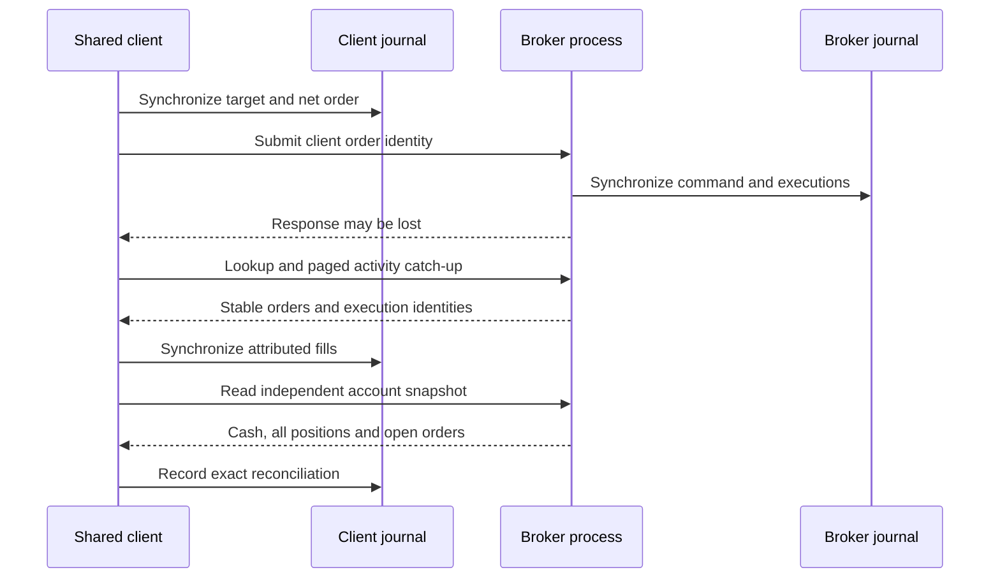

# Independent synthetic broker process

M5 extends the existing FIFO matcher into an independent, durable C++ peer.
The [registered policy](../research/synthetic_broker_protocol.md) defines the
account, lifecycle, fee, cash-availability and bounded-history assumptions.
The process and in-process routes use the same service and matching core.
Windows Release acceptance is complete, with its evidence recorded below.

## Ownership and publication

| Owner | Responsibility |
| --- | --- |
| `SimulatedBroker` | One independent broker cash balance, five inventories, FIFO orders, quote budgets and lifecycle transitions |
| `BrokerState` / `BrokerService` | Typed command validation, broker order identities, paged activities and schema-5 durable replay |
| `ChildChannel` / `ProcessBrokerPeer` | Owned child process, anonymous pipes, bounded framing, correlation and deadlines |
| `JournaledSharedCapital` / `SharedBrokerSession` | Durable client intent and ownership, activity catch-up, exact reconciliation and fail-closed routing |
| `ProcessBrokerReport` | Saved broker/client ledger views and cash paths; no alternate financial model |
| `verify_process_broker.py` | Independent integer FIFO/account reconstruction, logical responses, client attribution and evidence identities |

The broker never imports a client balance or position to manufacture agreement.
Client orders are synchronized before dispatch; broker commands and their
results are synchronized before a response or new activity becomes visible.
A crash can therefore leave a committed broker operation whose response the
client never received. Order lookup and stable activity history resolve that
case before reconciliation, without submission replay.



## Lifecycle and independent resources

The peer admits five-instrument orders against one cash pool and symbol-keyed
inventory. Pending buys reserve limit notional plus their fee ceiling; pending
sells reserve remaining shares. Cancellation requests release neither resource
before terminal confirmation. The book permits thirty-two open broker orders;
the shared client retains its stricter five-order bound.

DAY residuals expire when the virtual clock reaches the session close. IOC
orders consume current fresh liquidity once and cancel their residual. GTC
orders persist across sessions and process restart. Matching uses the existing
per-symbol finite bid/ask budget and arrival ordering; duplicate quotes do not
replenish it. Quotes carry separate source and receipt clocks.

The fixed engineering fee is USD 0.00001 per filled share on both sides, exactly
10,000 nanodollars. Cash, fees and quantities use integer arithmetic. Filled
sale proceeds become immediately available on trade date in this synthetic
model. Settlement receivables, exchange queue priority, impact, real broker
entitlements and observed execution costs are not represented. M6 separately
assesses declared cost and execution stresses.

Managed replacement uses M4's target ownership: cancel the old order, retain its
frozen claims through race fills, then cross free inventory and submit only the
residual under a new client identity after terminal cancellation. The shared
session currently dispatches DAY limits. The peer's IOC and GTC interfaces are
verified directly; they are not silently selected for strategy targets.

## Recovery, process framing and limits

The independent broker journal is schema 5 with a named model, account identity
and registered policy hash. Existing client schema 4 and legacy schemas 1-3
retain their contracts. Mismatched/unsupported peer headers are rejected rather
than migrated. Stable order, report, execution and command identities survive
replay. A repeated command is idempotent only when its complete contents match.

The parent launches the worker directly, without a shell or sockets. Anonymous
pipes carry four-byte big-endian lengths and bounded JSON envelopes. The parent
checks protocol version and request correlation and owns timeout, termination
and reaping. Windows uses binary pipe streams and bounded synchronous writes;
POSIX uses nonblocking pipes and `poll`. The default exchange budget is five
seconds. Diagnostic-only stop/pause-after-commit controls exercise response
ambiguity and timeout without changing the financial model.

Activity pages contain at most sixteen consecutive records. Missing, duplicate,
reordered or future activity cursors close client routing before that page is
applied. A reconnect catches up while the client gate is closed, then compares
cash, all five positions and complete open-order terms. Contradictory snapshots
never overwrite the client. Broker rejection is ingested with routing closed,
so it cannot trigger an automatic retry loop. A known absent order after an
uncertain send does not release a client reservation by inference; the gate
stays closed if the independent snapshot cannot reconcile.

A failed or uncertain broker append latches its writer. Recovery distinguishes
no append, an incomplete tail and a complete synchronized append with a lost
response. Incomplete-tail recovery writes a separate verified prefix and keeps
the damaged source; complete corruption is rejected without truncation.
Exclusive writer locks prevent competing owners. The registered record, order,
quote, activity, frame and segment bounds remain finite. This edition does not
compact an active broker segment or run an autonomous exchange clock.

## Reproduction and evidence

1. Build the existing solution in **Release | x64**, or run
   `py -3 -B build.py --configuration Release`.
2. Run `process_broker_diagnostic.exe`. It launches its sibling
   `synthetic_broker_peer.exe` automatically; the worker is not a separate manual
   launch step. Two deliberately malformed requests stop their child peers;
   these expected faults are checked by the parent.
3. Verify the actual printed directory:

```sh
py -3 -B research/verify_process_broker.py scratch/runs/process_broker_0 --self-check
```

The twelve families cover process parity/framing; FIFO/fees/liquidity; DAY;
IOC; GTC; managed replacement; resource rejection; delivery faults; ambiguous
submission; client restart; broker restart; and storage failure. A simultaneous
five-instrument case connects all fifteen owners to the real child process.
The suite also checks paths containing spaces, malformed and mismatched reply
envelopes, bounded activity pages and open-order admission.

The report selects a scenario and broker/client ledger, then replays committed
inputs beside exact order and inventory records. Its cash plot uses saved-event
index and an explicitly local USD axis. Virtual receipt clocks are not measured
network latencies. `calls.json` retains logical peer commands and responses;
the journal owns financial truth even when a response is absent.

The independent verifier rebuilds broker decisions, fees, quote consumption,
lifecycle and stable activities, checks read responses at their actual stream
position, and replays M4 client attribution against those reports. Ten semantic
self-checks deliberately change cash, reservations, cursors, fees, liquidity,
order side, lifecycle, schema and owner attribution without relying on hashes.
It creates `review.zip` with the summary, report, logical calls and small
synthetic journals. No private archive, credential or network request is needed.

The Windows review below complements the local verification. The existing v1
research and publication remain unchanged, and 2024-2025 strategy inputs stay
reserved. Operational completion does not imply a historical return or real
broker validation.

## Local verification record

GNU 13.3.0 Release compiled all twenty Linux applications with warnings as
errors. The constructed suite passed 313 checks in twelve families and launched
twenty-one native child processes. Independent verification reconstructed
139 broker commits, 98 client inputs and 294 logical peer calls, including the
five-instrument/fifteen-owner account and both directions of fee accounting.
All ten semantic-corruption checks passed. The 28 saved-ledger selector branches,
237 saved event views and four header-only views executed; representative cash
paths were rendered and inspected. A full browser layout check was unavailable.

AddressSanitizer and UndefinedBehaviorSanitizer passed the changed matcher,
broker service, process adapter, client bridge, shared-account/journal paths,
report and both native entry points. Other library units were not instrumented.
LeakSanitizer was disabled because process tracing prevents its execution in
the local verification environment. The existing 259-check combined demo,
182-check shared-capital diagnostic and 187-check panel suite passed, together
with their independent references and publication hash/link checks.

The original eleven frozen input/protocol identities remain unchanged. The
separate broker policy adds a twelfth registered identity. Windows Release
acceptance is recorded below.

## Windows acceptance

The Windows Release diagnostic used MSVC 19.51.36260 and passed all 313 native
checks in twelve scenario families across twenty-one child processes on
28 October 2026. Independent review rebuilt 139 broker commits, 98 client
inputs and 294 logical peer calls from the uploaded evidence. All ten semantic
corruption checks passed. The review covered FIFO/liquidity, fees, DAY/IOC/GTC,
managed replacement, response ambiguity, both restart directions and durable
write/tail failures, including simultaneous five-instrument ownership.

All 313 check labels and all twelve final scenario-state records matched the
verified GNU run exactly. All 28 accepted broker/client journals were also
byte-identical to the GNU reference. The separately uploaded summary, HTML and calls file
matched the ZIP byte for byte. All 28 ledger selectors, 237 saved event views,
four header-only views and navigation boundaries executed successfully. This
checks controller behavior and saved data; it is not a full browser layout review.

| Accepted record | SHA-256 |
| --- | --- |
| Uploaded review ZIP | `4bc84a1a916aa13ff534b34face6f04a2595e59f79fbc680a53b0042ddf90c61` |
| Summary | `1b14dabee58b7073e59ce47b95d57ce41d61a3c25ed29f3044a9d85073730915` |
| HTML report | `4d0a914c9c7bdc953ab433b72986fbdbc0c9023d86968b4ca3a6ca211fc81a26` |
| Logical peer calls | `95bc9c625e51e049fa303c407dc65a452ce68ee9dcaa3d43bff92843701dc137` |
| Reported native build-source inventory | `73ffad9b29f11bb92ee2b596ab3fe8bd4939a28faded175f58f96a742d6b7179` |

The source inventory identifies reported producer-file bytes; it is not an
independently established Git commit. The ZIP contains the summary and all 32
manifested synthetic artifacts, including retained rejected files. The review
therefore requires no private market archive. Network requests and external
broker observations were zero; no historical strategy was scored and no
reserved 2024-2025 strategy input was opened. M5 is complete. The subsequent
[M6 acceptance](cost_execution.md#windows-account-acceptance) records cost,
execution and daily-risk findings with their economic coverage limits.
