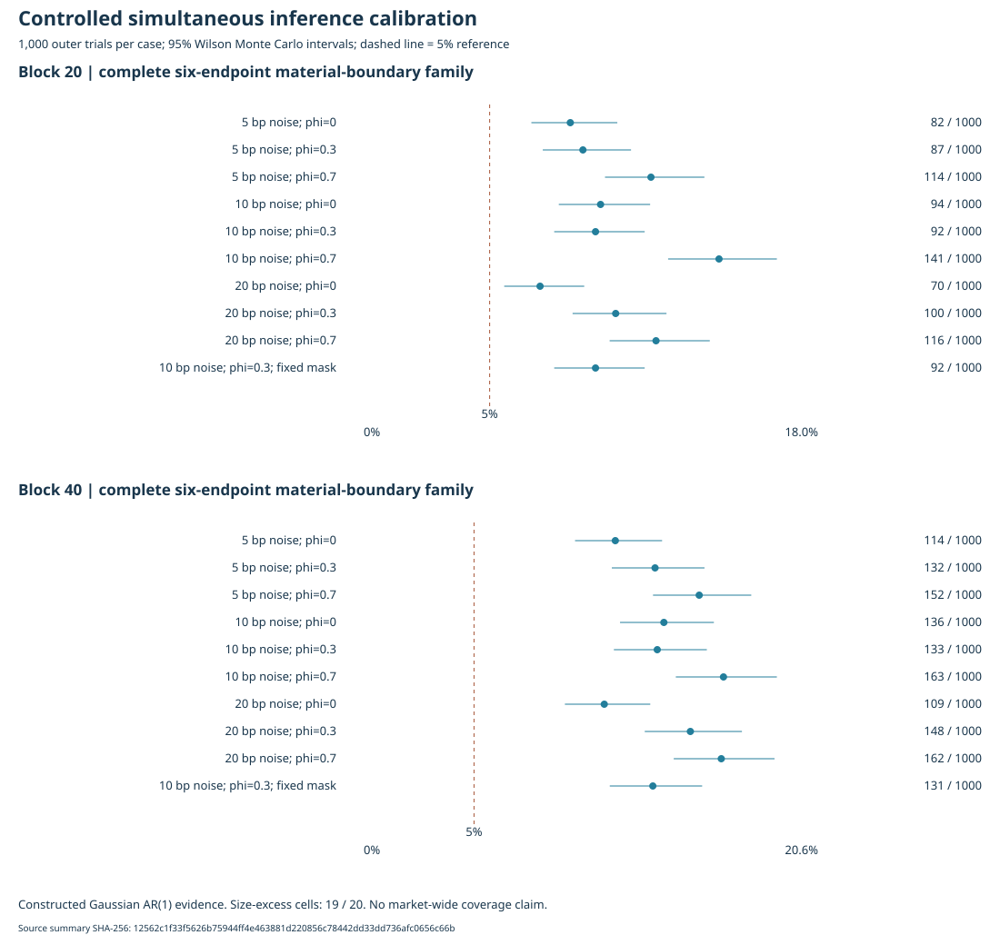

# Integrated validation and executable freeze

M8 follows the accepted M0-M7 work. The build pins
[validation_protocol.json](../research/validation_protocol.json) to SHA-256
`587ff9244737e15d61ab91c4dff4a19bfd9cbbe546788e742cc684388e251b54`.
It retains the original extension protocol, strategies, fourteen secondary cases,
material increments, costs and delays. Provider 2024 evaluation and its final
executable freeze require independent verification; 2025 remains reserved for M9.

## Controlled inference calibration

The original six-endpoint `FullCalendarInference` kernel is reused. Its fixed
original-sample calendar-indexed influence-function HAC studentizer uses Bartlett
weights through lag `block-1`. Joint non-circular moving-block resampling retains
calendar gaps. Simultaneous one-sided lower bounds are

$$L_j=\widehat\theta_j-c_{0.95}\widehat s_j.$$

The complete family is retained when an endpoint is unavailable. Coverage still
requires 200 observations and 80% of calendar slots. Blocks 20 and 40, 10,000
resamples and seed 290026 are unchanged. Caching stores immutable draw indices
only; each outer trial estimates its own moments, covariance and bootstrap law.

Nine cases combine daily noise of 5, 10 or 20 bp with stationary Gaussian AR(1)
coefficient 0, 0.3 or 0.7. A tenth uses 10 bp, coefficient 0.3 and fixed missing
slots 4, 14, ..., 244 in a 252-session calendar. It retains 227 observations.
There are 1,000 independent-seed outer trials per case and two block lengths,
for 20,000 complete-family experiments. Short `--check` mode uses four outer
trials per case and cannot authorize provider validation.

Eight latent processes start at independent stationary standard normals:

$$X_{k,t}=\phi X_{k,t-1}+\sqrt{1-\phi^2}\epsilon_{k,t}.$$

MT19937-64 uses the existing high-52-bit midpoint, cosine Box-Muller mapping,
without cached normal variates. Let $Z_{j,t}=(X_{0,t}+X_{j+1,t})/\sqrt2$ and
$B_t=0.5\sigma X_{7,t}$. The first four candidates are
$A_{j,t}=B_t+\delta_j+\sigma Z_{j,t}$. For annual CER with risk aversion 3,

$$\operatorname{CER}(A)-\operatorname{CER}(B)=252\{E[A-B]-1.5[\operatorname{Var}(A)-\operatorname{Var}(B)]\}.$$

Its candidate mean shift is $\delta_j/252+1.5\sigma^2$, so the known population
increment equals the material boundary. Population and finite-sample variances
remain distinct under serial dependence. The sixth controlled loss-difference
score is $\delta_j+20\sigma Z_{j,t}$ against zero; it is not an asserted model
for individual market QLIKE losses.

The diagnostic counts any simultaneous lower bound above its true material
boundary. It reports 95% Wilson Monte Carlo intervals and a one-sided binomial
size-excess test under 0.05, with cutoff `0.05/20` across case/block cells. These
are intervals for simulation frequencies, not market returns. Undefined families
are retained separately. No market-wide coverage certification follows from a
pass under these declared Gaussian cases.

Prespecified alternatives use the Bonferroni 80%-power planning shift based on
the exact stationary AR(1) variance of the full-calendar mean. CER shifts scale
by 252 and QLIKE shifts by 20. Native checks compare location equivariance with
actual shifted-family replays. The masked case keeps the same planning shift.
Detection rates do not establish power for trading strategies, especially if
size control fails.

A size-excess finding is retained. It does not trigger a different critical
value, block, endpoint or data filter. Descriptive 2024 validation can proceed,
with supported inference claims withheld and the warning carried into the
executable freeze. Heavy tails, heteroskedasticity and outcome-dependent missingness
remain outside this controlled diagnostic's claim scope.

## Verification and remaining M8 work

`verify_inference_calibration.py` independently reconstructs every outer sample,
estimate, HAC error, bound and aggregate. It fully reruns the first and last
outer trial per case/block: 40 complete bootstrap reference replays. The other
native critical values are authenticated outputs; their full bootstrap laws are
not independently rerun. Static coordinates and detection tables are checked,
and semantic corruption tests bypass artifact hashes. The exported standalone
SVG packages verified native coordinates rather than a second calculation.

The integrated evaluator composes existing reference and account engines under an
explicit 2024 capability. Features warm from 2016; fresh evaluation capital is
separate from stopped development accounts. Unit references start exactly 252
exchange sessions before the evaluation boundary and never restart after a
stop. All fourteen variants remain present; no best variant is selected. The
last forecast is unavailable if it would need a 2025 target price.

A verified provider 2024 run must freeze the exact executable, source inventory,
input registration, policy, calibration and validation identities before an
explicit M9 final run. Constructed verification does not constitute private
Windows historical acceptance. M9 final evaluation and M10 publication follow.

## Controlled calibration acceptance: GNU Release

The full constructed experiment completed on 30 October 2026 with GNU 13.3.0,
Release. Independent verification passed all **20,000 outer-family moment/HAC/
bound checks**, **40 complete reference bootstrap replays** and **six semantic
corruption checks**. All 20,000 families were numerically available. No provider
strategy prices were loaded.

| Record | Identity / result |
| --- | --- |
| Native summary SHA-256 | `12562c1f33f5626b75944ff4e463881d220856c78442dd33dd736afc0656c66b` |
| Compiled source-inventory SHA-256 | `d0bec50b856a850ea11c3e3bfdd9ecb9609f6e14191029b117fdb66e6701e9e8` |
| Known-boundary family exceedance frequency | **7.0%-16.3%**, versus the 5% reference |
| Size-excess cells at the registered `0.05/20` cutoff | **19 of 20** |
| Undefined / unavailable families | **0** |
| Consequence | Retain the procedure; withhold supported inference claims; allow descriptive 2024 evaluation under the registered rule |

The [twenty-cell table](evidence/m8_inference_calibration.csv) retains every
frequency, Wilson Monte Carlo interval, binomial p-value, diagnostic decision and
source identity. The standalone figure packages **verified native coordinates**;
its display labels do not alter the calculation. The independent verifier
exports it as `calibration.svg` and records its hash in the verification receipt.

All twenty empirical frequencies exceed 5%, but one does not cross the predefined
multiplicity-adjusted size-excess cutoff. No threshold is changed to relabel that
cell. Shifted-effect detection rates cannot be interpreted as calibrated test
power when size control fails. Existing M7 bounds remain numerical diagnostics;
this evidence does not support a nominal 95% simultaneous confidence claim from
the current procedure. No resampling setting is retuned after this result.

This numerical acceptance does not establish Windows/MSVC execution, provider
2024 validation or a provider executable freeze. Those remain M8 acceptance
prerequisites; 2025 strategy prices remain reserved.

## Integrated evaluation cohorts

`PanelEvaluation` composes the existing primary, secondary, continuous risk and
shared-capital engines. It does not maintain alternative strategies or accounting.

| Object | Initialization and start | Failure treatment |
| --- | --- | --- |
| Features, forecasts and causal conditions | Provider history warms from 2016; no parameter/history reset in January 2024 | Existing missing-slot and causal-history rules |
| Continuous risk and shared accounts | Fresh USD 100,000 per evaluation case in 2024; first deployable prior forecast where required | Permanent stops, partial positions and missing tails retained |
| Genuine unit references for matching | Exactly 252 exchange sessions before the first evaluation date: 29 December 2022 for 2024 | No restart after a stop; unavailable returns stay unavailable |
| Funded matched accounts | Fresh 2024 capital; sizing uses the preceding 252 genuine unit-return slots | Existing unlevered sizing and stop rules |
| Intraday cost/delay references | Identical frozen decisions, five costs and two delays | Eligible-date products remain distinct from continuous wealth |

A fresh evaluation cohort does not repair or extend a stopped M7 ledger. All
fourteen predefined variants remain present; none is selected as a replacement.
The last forecast is unavailable when its next-session target would require a
2025 price. Terminal liquidation uses the existing observed current-year
reference and cost convention. No interpolation, pre-gap liquidation or capital
reset extends an unavailable path.

The constructed check uses the full 2022-2024 exchange calendar, existing analytic
price/volume formula and four missing-minute faults. QQQ distributions of 1.25
at source slot 268 and 0.75 at slot 600 are paid at slots 271 and 603. The second
exercises ex/payment accounting within 2024. The price-feed dividend measurement
and account cash events consume the same declared action records. Python
independently reconstructs the analytic observations and both cash events.

The 2024 cohort remains retrospective, with the project's recorded prior research
exposure. It is not advertised as globally unseen data. M7 failures do not
disappear when the calendar changes. Relative increments alone establish neither
own-account profitability nor deployable trading performance.

## Access, reports and executable freeze

Default development readers and verifiers retain their pre-2024 boundary.
`PanelEvaluationAccess` binds calendar, origin, unit-reference start and calibration
identity. A provider 2024 capability requires the full independently verified
calibration receipt and unchanged numerical core. A constructed capability cannot
authorize provider prices. The existing M2 registration, raw-response hashes,
source-resolution rules, eligibility masks and corporate-action identities are
authenticated through the same reader. No acquisition or broker request is made.

The parent report links four full child reports: cost/delay references,
continuous/shared accounts, secondary/matched accounts and primary stability.
All 77 primary and 345 secondary/matched series remain present, including missing
results. Coverage, exposure, turnover, drawdown, concentration, causal conditions
and paired full-calendar uncertainty accompany returns. Calibration size excess
and complete-family availability are recorded separately.

`verify_panel_evaluation.py` invokes the existing independent raw-source,
strategy-history, Decimal fractional-account and integer shared-account oracles
under an explicit scope. It reconstructs all derived series and inference,
checks static coordinates and links, and rejects semantic corruptions without
relying on hash changes. A receipt is written only after every child passes.

`panel_evaluation --freeze` requires that receipt and the exact evaluated binary.
It copies the executable into a new run directory and binds its hash, source
inventory, M2 registration, policy, calibration and verified 2024 identities.
No setting is selected from validation. Verification and freezing must precede
another build. The frozen copy survives later builds overwriting the ordinary
Release executable.

The same binary already contains an explicit `--final` branch so it can be frozen
before M9. That branch requires a verified provider 2024 freeze and the exact
frozen executable. A constructed freeze cannot authorize provider 2025 access.
M8 commands do not execute the final branch. These are workflow integrity guards,
not a security claim against an operator editing the program and its receipts.

M8 acceptance still requires reviewed Windows provider 2024 execution and the
verified provider freeze. GNU constructed checks and controlled calibration do
not substitute for that evidence. M9 performs the frozen 2025 retrospective
evaluation; M10 consolidates publication, visual evidence, benchmarks and release.

## GNU constructed integration acceptance

The 30-application GNU 13.3.0 Release build passed with warnings treated as
errors on 30 October 2026. The final constructed evaluation used 753 source
sessions in 2022-2024 and 252 evaluation dates. Independent verification passed
all 77 primary and 345 secondary/matched series, fourteen causal variants,
Decimal funded accounts, integer shared accounts, four joint block lengths,
static figures and ten hash-independent semantic corruption checks.

| Record | SHA-256 |
| --- | --- |
| Constructed evaluation summary | `b48384150beb8478e294e3dd6da240ec7be1e612cabd79df7688ce87688bb9d3` |
| Compiled source inventory | `054e741e98398dfd045a20a03a64241a031a87467697b9f15b4ca98f9247d0d9` |
| Frozen constructed runner | `d5824e68d22462517bf402501a291b37fa64c479261fab2fb624cbbf3f4a183c` |

The exact runner/specification freeze passed independent verification. The
synthetic freeze was rejected for provider 2025 access. Its short engineering
calibration does not establish inference size control and cannot authorize
provider data. The full calibration above remains the separate Monte Carlo
acceptance record.

The 259-check demo passed. Default cost/delay, continuous-account and primary
stability records retained byte-identical numerical evidence. Secondary decisions,
ledgers, derived observations and inference summaries also remained exact; two
exported reversion coefficients differed by one floating-point step and passed
the existing independent numerical tolerances. Its fourteen numerical/semantic
checks passed. All fourteen frozen research input identities were preserved.
Report PDFs were rendered and the integrated, calibration and primary figures
were visually reviewed. None of these constructed results is a historical 2024
performance result or a Windows/MSVC acceptance claim.
